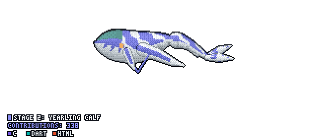

<table>
  <tr>
    <td width="150" align="center" valign="middle">
      

    </td>
    <td valign="middle">
      <h1 style="margin: 0;">Manish Rana</h1>
      <h3 style="margin: 4px 0;">Developer · IT Student</h3>
      <h3>
        <b>Things I love to do:</b> Building things with code and exploring technology.
      

      <h3>
        Nepal · <a href="https://rana-manish.com.np">Portfolio</a>
      

    </td>
  </tr>
</table>
  
  

## Technologies & Tools

### Frontend

  

### Backend

  

### Tools

  

## Featured Projects

These projects were done purely for practice purpose and will change into real projects near future. 

<ul>
  <li>
    <a href="https://test12418.netlify.app/" target="_blank"><b>Creama & Co</b></a>
    : It is the a Cafe Site in a minimalist design.
  </li>

  <li>
    <a href="https://cheery-pegasus-71d26c.netlify.app/" target="_blank"><b>Gokyo Bistro</b></a>
    : It is a Home Delivery Food website.
  </li>

  <li>
    <a href="https://github.com/manishcodes-dot/craft-avatar.git" target="_blank"><b>NPM Package One</b></a>
    : It is a npm packages that can create random avatar for your projects.
  </li>
</ul>

## Currently Working On
<ul>
  <li>
    <a href="https://github.com/manishcodes-dot/kosh" target="_blank"><b>Kosh</b></a>
    : It is simply a img storing site that can also be shared with others.
  </li>

  <li>
    <a href="https://github.com/manishcodes-dot/Live-interview-website" target="_blank"><b>interview</b></a>
    : It is a simple interview site to hire developer based on there skills, which is tested by either face to face by video call with build in code editor or with given assessment.
  </li>
</ul>

## Way to Connect With Me 
---
