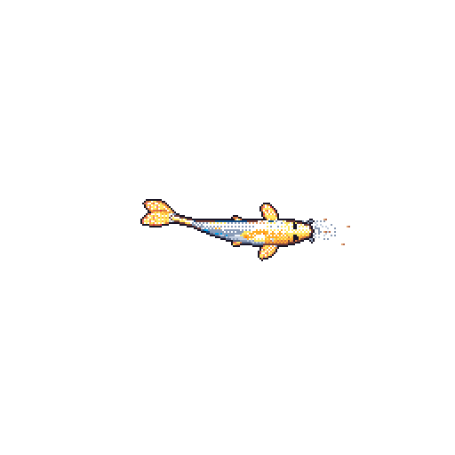

<table>
  <tr>
    <td width="150" align="center" valign="middle">
      
    </td>
    <td valign="middle">
      <h2 style="margin: 0;">Manish Rana</h2>
      <h3 style="margin: 4px 0;">Developer · IT Student</h3>
      

        <b>Things I love to do:</b> Building things with code and exploring technology.
      

      

        Nepal · <a href="https://rana-manish.com.np">Portfolio</a>
      

    </td>
  </tr>
</table>

---

## Personal Portfolio

- [About Me](https://rana-manish.com.np/#about)
- [Skills and Technologies](https://rana-manish.com.np/#skills)
- [Featured Projects](https://rana-manish.com.np/#projects)
- [GitHub Activity](https://rana-manish.com.np/#github)
- [GitHub Profile](https://github.com/manishcodes-dot)
